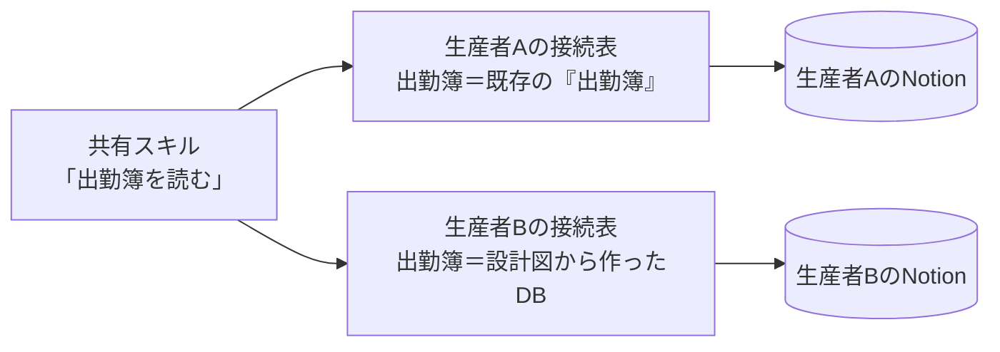
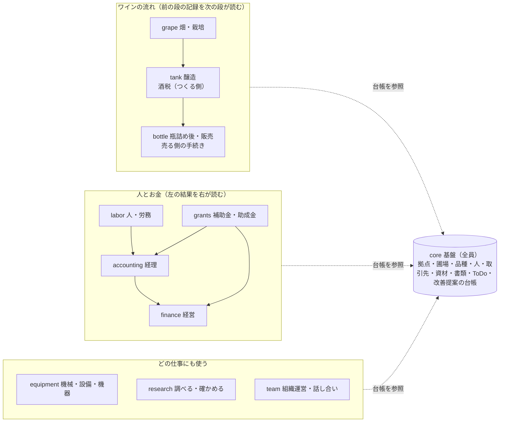

# 全体設計

> **一言でいうと**：ワインをつくる別々の会社どうしが、自分のデータは手元に置いたまま、AI（Claude）に渡す「作業の手順書」と「知識」だけを共有し、使うほど全員のAIが賢くなるようにする仕組み。

参加する生産者は、それぞれClaudeとNotionで仕事をしている。会計や給与のような会社のデータは見せ合えないが、「AIにこう頼むとうまくいく」という手順や、農薬・病害虫などの知識は共有したほうが全員が得をする。この文書は、その共有の仕組みの設計図。2人の生産者で始め、ほかの生産者にも広げる。

向かう方角（決定版ではない）は [北極星のアイデア](north-star.md) にまとめてある。仕事の進め方を共有して育てる仕組みは、業界を問わず「〇〇コモンズ」として作れる、という考え方。

この文書の読み手は「Claude・Notion・GitHubを使ったことがある高校生」を想定している。知らない言葉は、すぐ下の用語表で開いている。

この文書に出てくる言葉

| 言葉 | 意味 |
| --- | --- |
| スキル | Claudeに渡す作業の手順書。「出勤簿から給与記録を作るときは、まずこれを確認して…」のような手順を書いたファイル |
| プラグイン | スキルなどをまとめて、Claudeに入れたり外したりできるようにした箱 |
| リポジトリ | GitHub上のファイルの置き場。誰がいつ何を変えたかを残しながら一緒に直せる。このリポジトリが共有の置き場 |
| マーケットプレイス | リポジトリに置いたプラグインの一覧。Claudeに一度登録すると、一覧から入れられ、更新も自動で届く |
| DB（データベース） | Notionの表。出勤簿、圃場一覧など |
| DBの設計図 | DBにどんな列（プロパティ）があり、どの表とつながるかを書いたもの。中のデータは入っていない |
| 🧭 AI設定ページ | 各自のNotionに1枚置く自分用の設定。会社名、どのDBを使うか、自分だけのルールなど |
| MCP・コネクタ | ClaudeをNotionやfreeeなど外の道具につなぐ接続口 |
| Hook | Claudeが作業を始めるときなどに、自動で実行される小さな処理 |
| GitHub Actions | GitHubの上で決めたタイミングに自動で動く処理。審査や配布をAIに自動でやらせるのに使う |

## 1. ひと目で：何を共有して、何を手元に残すか

上の段が共有するところ、下の段が各自の手元。共有するのは「手順書（スキル）」「ルール」「DBの設計図」「知識」だけで、会社のデータは下の段から出ない。手順書は上から各自に届き、使って気づいたことはデータを抜いたうえで上に送られ、全員の手順書が良くなる。以下の章は、この図の各部分を順に説明する。

## 2. 同じ手順書が、人ごとに違うDBで動く理由

生産者Aの出勤簿と生産者Bの出勤簿は、名前も場所も違う。それでも同じスキルが両方で動くのは、スキルの中ではDBを「出勤簿（`attendance`）」のような共通の呼び名（**論理名**）で呼び、各自のAI設定ページにある**接続表**が「自分の場合はこのDB」と対応づけるから。スキルは毎回まず設定ページを読む。

すでにDBを持っている人は、作り直さずに対応づけるだけ。これから始める人は、初期設定のスキルが設計図からDBを組み立て、接続表も埋める。接続表に無いDBを使うスキルは、勝手に別のDBを使わず「このDBが未接続です」と止まる。

DBの列（プロパティ）は3種類に分ける。

| 種類 | 意味 | 共有スキルの扱い |
| --- | --- | --- |
| 共通・必須 | 設計図で必ずあるもの | これが無いとスキルは動かない |
| 共通・任意 | 設計図にあるが、入れるかは各自 | あれば使い、無ければ飛ばす |
| 自分用 | 各自が自由に足したもの | 消さない・書き換えない |

自分用の列を試して、良ければみんなの共通にする流れ

1. **試す**：自分のDBに列を足して使う。週1の自動タスクが設計図と比べて見つけ、設定ページに「自分用・試用中」と記録する
2. **測る**：1か月たったら、何件に値が入っているか、どんな値かを数える
3. **提案する**：よく使われていれば「共通・任意にしては」という改善提案を自動で作る。送るのは用途・型・選択肢・件数だけで、値そのものは送らない
4. **共通にする**：設計図に足し、それを使えるスキルも直す。任意の列を足しても他の人のDBは壊れないので、承認は1人でよい（危険度L2、6章）
5. **配る**：提案した人は接続表で対応づけるだけ。他の人には、各自のClaudeが「この列を足しますか」と聞く

2人が似た列を別々に作っていたら、1つにまとめる案が出る。任意を必須にする・型を変える・共通から外す、は各自のDBの作り直しが要るので、全員の承認が要る（L3）。共有したくない列は、設定ページで「共有しない」にしておけば提案は出ない。

## 3. 手順書の届き方と、自分に合わせる方法

| 届け先 | 届き方 |
| --- | --- |
| Claude（アプリ・Claude Code） | このリポジトリを、Claudeの「プラグイン」画面で一度マーケットプレイスとして追加し、要るプラグインを入れる。プラグインはアカウントに入るので、どのプロジェクトでも効く。新しい版は自動で届く |
| Notion AI | 同じスキルの写しを、各自のNotionのスキルDBに入れる。元はこのリポジトリにあり、Notion側では直さない。週1の自動タスクが新しい版に差し替える |
| 全員が守る基本ルール | 基盤（core）プラグインの「基本ルール」スキルを、作業を始めるときにHookで毎回読み込む |

共有の手順書を自分に合わせるのは、軽い順に4段階。上で足りるなら下に降りない。

| 段階 | やること | どこで | 例 |
| --- | --- | --- | --- |
| 1. 入れる・外す | プラグインを入れたり外したり | Claudeのプラグイン画面 | 醸造しない人は醸造（tank）を外す |
| 2. 値を変える | 設定値を書く | 🧭 AI設定ページ | 部門＝本社・第2圃場 |
| 3. 自分ルールを足す | スキルごとの「自分ルール」欄に書く | 🧭 AI設定ページ | 「給与記録では現物支給も確認する」 |
| 4. 自分だけのスキル | 共有しないスキルを持つ | 自分のNotionのスキルDB | 自社のワイン紹介文の書き方 |

共有の手順書をコピーして書き換えることはしない。コピーすると共有側の改善が届かなくなるから。段階3で足りないほど違うなら、共有の手順書に「選べる道」を足す改善提案を出す。

Notionの共有機能で、別の会社とスキルを共有しない理由

同じNotionのワークスペースの中なら、スキルもページなので普通に共有できる。でも別の会社とは向かない。

- 各自のNotion AIは各自のワークスペースで動く。別のワークスペースのスキルを共有しても、そこから使えるかはNotionの公式ヘルプに書かれていない
- 使えたとしても、編集できる人が直すと全員に即座に反映され、版も確認の手順もない。片方の都合で直したものが、もう片方を壊しうる
- だから共有スキルの元はこのリポジトリに置き、各自のNotionには写しを入れる

## 4. 中身：分野ごとの11のプラグイン

いまある資産からではなく、ワイン生産者が関わる仕事の分野から分けた。各自のNotionやClaudeのプロジェクトも、逆にこの分け方に合わせて育てていく。DBの設計図も同じ分け方で作り、どの分野も使う台帳（圃場・人・資材など）は基盤（core）に置く。いま入っているのは core だけで、ほかは順に足す。プラグインごとの中身、DBの一覧、分けた理由、名前の付け方は [プラグインとDBの設計図](plugins-and-schemas.md) にある。

## 5. 知識の共有：知識コモンズ

農薬・病害虫・微生物・論文のような知識は量が多く、「この情報はどの論文に書いてあったか」を表どうしのつながり（リレーション）で管理する必要がある。だからプラグインには入れず、知識専用のNotionに置く。

- **置き場**：知識専用のNotionワークスペース「Winegrowers Commons」（2026年11月に作成）。メンバーは世話役の1人だけで、いまは無料プラン。無料プランはメンバーが1人ならブロック数の上限がなく、ゲストは10人まで。ゲストが10人を超えたらプラス（1人分、月$10）にする。プラスはゲストの人数に上限がない
- **人**：参加者はゲストとして招待され、Notionの画面で直接読み書きする
- **AI**：自分たちで小さな接続口（MCPサーバー。以下「入口」）を作って置く（[servers/commons-mcp](../servers/commons-mcp/)、Cloudflare Workers の無料枠）。Notion の公式コネクタはワークスペースのメンバーしかつなげないので、ゲストの参加者はこの入口から読み書きする。参加者コードで本人を確かめ、書き込みには書いた人の名前が付く。知識ワークスペースのいちばん上のページを入口に共有すれば、その下が全部届く。各自は自分のClaudeに入口を「コネクタ」として一度追加するだけ。Notionへのログインを使わないので、何度も認証を求められることもない
- **入口が守らせるルール（これから）**：出典が無いと書けない、どのAIが書いたかを記録、AIが書いたものは「下書き」、会社のデータらしきものは受け付けない。毎晩、審査役のAIが下書きを出典と照らし合わせ、問題なければ「確認済み」にする

細部：検索・会社のデータとのつなぎ方・本・将来

- **検索**：Notionの検索だけでは弱いので、入口の中に検索用の索引を持つ。Notionから自動で作り直す使い捨てのもので、人が直す2つ目の元にはしない
- **会社のデータとのつなぎ方**：自社のDB（防除歴の農薬など）に知識のIDを持たせる。Notionのリレーションはワークスペースをまたげないので、IDでつなぐ
- **本**：本文は共有しない。書誌・目次・どの章に何があるか・自分の言葉の要点だけを参考文献に置き、本文はその本を持っている人のClaudeが自分のコピーを読む
- **ビジネスプランにしない理由**：ビジネスで増えるNotion AIは、お金を払った1人にしか付かず、ゲストは使えない。読み書きは入口を通して各自のClaudeで行うので要らない
- **将来**：入口の使い方はそのままに、奥の置き場だけ、品種や資材などの共通の台帳を管理するアプリに差し替えられる

検討して外した案

| 案 | 外した理由 |
| --- | --- |
| 全員をメンバーにする | 無料プランのままだとメンバー2人以上でブロック数に上限（1,000）がかかり、プラスにすると1人月$10ずつ増える。Claudeに2つ目のNotionをつなぐ必要があり、入口でルールを守らせることもできない |
| 共有のNotionアカウント | Notionはログインの共有を想定していない。誰が書いたかも残らない |
| Driveにコピーを置く | 二重管理になり、AIから書き込めない |
| Googleスプレッドシートを元にする | 無料で各自のGoogle接続から読み書きできるが、長い文章の知識に向かず、Notionで育ててきた使いやすさを失う |
| Claude CodeでNotionを2つつなぐ | Claude Codeならできるが、アプリのClaudeやNotion AIには届かない |

それより前の案は [旧案と検討の経緯](history.md)。

## 6. 使うほど良くなる仕組み

誰かのClaudeが直されたら、その学びが全員の手順書に入る。気づく・集める・直す・確かめる・配るは全部Claudeが受け持ち、人は大きな変更を承認するだけにする。

学びは、効く範囲で置き場を分ける。全員に効くものだけが、上の輪に乗る。

| 効く範囲 | 例 | 置き場 |
| --- | --- | --- |
| その人だけ | 好み・書き方 | Claudeのメモリ |
| その会社だけ | 部門の分け方、自社の事情 | 🧭 AI設定ページの自分ルール |
| みんな | スキルの誤り、足りない手順 | 改善提案（名前・金額などを抜いて） |

変更は危険度で4つに分け、人の出番を決める。

| 危険度 | どんな変更か | 取り込み方 |
| --- | --- | --- |
| L0 | 誤字、出典つきのコツの追記、テストの追加、元に戻す変更 | 自動 |
| L1 | 手順の改善で、書き込み先・外への送信・確認の有無が変わらないもの | 自動（週報で知らせる） |
| L2 | スキルの判断や出力が変わる、新しいスキル、任意の列の追加 | ラベル「人の確認」を付け、提案した会社以外の1人が承認 |
| L3 | DBの設計図の変更、書き込みや外への送信が増える、基本ルールや審査ルールの変更 | ラベル「人の確認」を付け、参加者全員が承認 |

提案は基盤の「提案のしかた（propose-change）」の形で出す。どの層を変えるか（選べる道を足す／既定を変える／約束を変える）と、自分の設定で試した影響を必ず付ける。対立の多くは、既定を変えずに選べる道を足すことで、投票せずに片づく。参加者が増えたときの決め方の行き先は [北極星のアイデア](north-star.md)。

いまは、プルリクエストは自動チェック（validate）が通れば自動でマージされ、ラベル「人の確認」が付いたものだけ人を待つ。1社からだけ出た提案でも、誤りの修正や出典の更新はそのまま通す。好みによるものは「選べる道」として足し、最初の設定は変えない。

係ごとの動かし方（技術的な細部）

| 係 | 動かし方 | いま |
| --- | --- | --- |
| ① 記録係 | 基本ルールと、共有スキルの最後の「ふりかえり」手順に書く。「違う」「そうじゃなくて」と言われたときにHookで記録を促す | 基本ルールに記載済み。Hookはこれから |
| ② 運び係 | 各自のClaudeの定期実行タスク（週1、NotionとGitHubにつなぐ）。同じ話のIssueがあれば合流させる | これから |
| ③ 整備係 | Claude Code GitHub Actions。リポジトリの `CLAUDE.md` に作業ルールを書く。直し案には必ず再発を防ぐテストを付ける | 作業ルールは記載済み |
| ④ 審査係 | GitHub Actions（形の検証、個人情報の検出、互換性のチェック、`claude plugin eval`、Claudeの判定） | 形の検証と個人情報の検出は動いている |
| ⑤ 配布係 | GitHub Actions。版を上げ、変更点をまとめ、週報を話し合いの場に出す | 自動マージは動いている。週報はこれから |
| ⑥ 見張り係 | GitHub Actions（月1）。人がAIの判定を覆した例から、審査ルールの直し案を出す（L3） | これから |

プラグインの中に `CLAUDE.md` を置いても読み込まれないので、全員の基本ルールはスキル＋Hookで届ける。Claudeのメモリはアカウントごとで共有も移行もできないので、会社として残したいことは🧭 AI設定ページに書く。

## 7. 2人＋AIで話す場所

**Discord に決めた（2026年11月）。** 無料で、やり取りが消えず、AIから読み書きできる。

- 人どうしは Discord で気軽に話す
- AIは（これから）、Discord につなぐ MCP サーバーを通して、やり取りを読んで要点を拾い、知識コモンズや提案に回す。AIが常にいる必要はない
- 決まったこと・残す知識は Discord に置きっぱなしにせず、知識コモンズ（Notion）か、このリポジトリに移す。Discord は流れる場所、Notion とリポジトリはためる場所

検討して外した案

| 案 | 外した理由 |
| --- | --- |
| Slack（無料） | 見られる履歴が直近90日で、1年を超えると消える。Claude の公式の Slack 連携は有料の Slack が前提 |
| Google チャット | Google 公式の接続はあるが試験段階で、Google Cloud の設定が要る |
| LINE・Messenger | AIからやり取りを読めない |
| Chatwork | 使いづらい |
| Notion の共有ワークスペースで話す | チャットには向かない。ためる場所として使う |

## 8. この上に乗せていく仕組み

栽培データ（土壌分析・防除歴）をAIにつなぐ

- いまはExcelなどにあるデータも、先にDBの設計図（論理名 `soil_analysis`・`spray_records`）を決めておけば、接続表で指す先を差し替えるだけで、スキルは直さずに済む
- 栽培管理のアプリにつなぐときは、freeeと同じく各自が自分のアカウントでログインする形にすると、生産者ごとのデータの分かれ目がそのまま守られる
- 防除歴は生産者どうしで見せ合う文化があるので、形がそろえば知識コモンズの最初の題材になる

資金繰り：AIが自分から動く経営の相棒にする

freee・スプレッドシート・Notionへの接続は公式のコネクタで済む。足りないのは「言われなくても動く」部分で、定期実行タスクと経営ログで補う。

| 頻度 | AIが自分からやること | 人の出番 |
| --- | --- | --- |
| 毎週 | freeeの残高・未払いを見て、資金繰り表の予定とずれていないか点検し、経営ログに1行残す | 異常があるときだけ通知 |
| 毎月 | 前月の試算表で、予定と実績を更新する案と、気になる点（3つまで）を作る | 承認すると資金繰り表に反映 |
| 決算後 | 長期計画の更新案と、資金繰りの打ち合わせ資料の下書き | 打ち合わせで確定 |
| その都度 | 大きな支出・設備投資・補助金の話が出たら、資金繰りへの影響を試算して添える | 判断する |

税の計算の仕方と点検の仕方は農業法人に共通なので、まず1社で動かしてから共有する。

## 9. 進み具合・決めること・費用

| 段階 | やること | いま |
| --- | --- | --- |
| 0. 土台 | リポジトリ、core、自動チェックと自動マージ、各自の設定ページと接続表、10章の「確かめること」 | リポジトリ・core・自動チェック・自動マージは済み |
| 1. 2人目 | 2人目が導入（マーケットプレイスを追加して初期設定スキルを動かす）。1つのスキルを2人で使って直す | 招待済み |
| 2. 広げる | 経理・畑などを追加。知識コモンズを立ち上げる | これから |
| 3. 開く | ほかの生産者を招く。公開データ（気象・農薬登録など）の接続 | これから |

**決めること**

1. **次に入れるプラグイン**：推しは補助金（grants）と調べる・確かめる（research）。公開情報が中心で、すぐ使える
2. **知識コモンズの入口を置く場所**：Cloudflare Workers の無料枠に決めた（1日10万リクエストまで）

**費用**（共有の仕組みそのものに新しくかかるのは、知識コモンズの1席だけ）

| 項目 | 各自 | 共有 |
| --- | --- | --- |
| Claude | Pro 月$20（年払いなら月$17相当）以上。自動タスクを多く回すならMax | — |
| Notion（自分の会社） | 各自の契約のまま | — |
| 知識コモンズ | 0円（ゲスト） | 0円（無料プラン、ゲスト10人まで）。超えたらプラス1席 月$10 |
| GitHub | 0円 | 公開リポジトリなので自動チェックも無料 |
| 話し合いの場 | — | 0円（Discord） |
| 知識コモンズの入口 | — | 0円（Cloudflare Workers の無料枠） |

## 10. まだ確かめていないこと

- 「自動で同期」で、新しい版がアプリとClaude Codeに本当に届くか（マーケットプレイスを追加すると「自動で同期」が最初からオンになることは確認済み。版が上がったときに届くかはこれから）
- 作業を始めるときのHookが、アプリでも基本ルールを読み込むか
- 各自のNotionのスキルDBに入れた写しを、Notion AIから使えるか
- 週1の定期実行タスクが、Notionの改善提案を読んでGitHubに出せるか
- 知識コモンズの入口を、コネクタとしてアプリのClaudeやNotion AIから使えるか

公式情報で確認したこと・参照

- 非公開のGitHubリポジトリもマーケットプレイスとして追加できる（GitHubをつなぎ、Claude GitHub Appにアクセスを与える）
- 自分で追加したマーケットプレイスは「更新を確認」で更新でき、github.comなら「自動で同期」にできる
- プラグインの `userConfig`（入れるときに値を聞く仕組み）はチャットでは使われない。だから会社ごとの設定はNotionの設定ページに置く
- HookはCoworkとClaude Codeで動き、チャットでは動かない
- プラグインの中の `CLAUDE.md` は読み込まれない
- Claudeのメモリはアカウントごとで、別のアカウントへ移せない
- Notionのゲスト上限は、無料が10人、プラス以上は無制限
- カスタムコネクタ（自前の接続口）はPro・Maxでも追加できる

参照：[Use plugins in Claude](https://support.claude.com/en/articles/13837440-use-plugins-in-claude)・[Create a marketplace](https://code.claude.com/docs/en/plugin-marketplaces)・[Plugin manifest reference](https://code.claude.com/docs/en/plugins/manifest-reference)・[Plugin feature support across platforms](https://claude.com/docs/plugins/platform-support)・[Hooks](https://code.claude.com/docs/en/hooks)・[Channels](https://code.claude.com/docs/en/channels)・[Agent Skills API（Notion）](https://developers.notion.com/guides/agent-skills/overview)・[Claude pricing](https://claude.com/pricing)・[Notion 料金](https://www.notion.com/ja/pricing)・[GitHub pricing](https://github.com/pricing)

