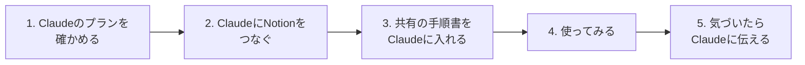

# はじめかた（導入マニュアル）

ClaudeとNotionのアカウントを持っていれば、20分ほどで始められます。GitHubは使わなくて大丈夫です。

この仕組みが何なのかは [全体設計](design.md) にあります。ひとことで言うと、**Claudeへの作業の手順書（スキル）をみんなで共有して、使いながら一緒に良くしていく仕組み**です。会社のデータは共有しません。

## 全体の流れ

GitHubのアカウントは要りません。手順書の置き場は公開されているので、Claudeがそのまま読みにいけます。

## 1. Claudeのプランを確かめる（1分）

共有の手順書（プラグイン）は、Claudeの有料プラン（Pro以上）で使えます。無料プランなら、Claudeの設定画面からProに切り替えてください（2026年11月時点で月20ドル。年払いなら200ドル）。

## 2. ClaudeにNotionをつなぐ（3分）

Claudeが自分のNotionを読み書きできるようにします。

1. Claude（claude.ai かアプリ）で「カスタマイズ（Customize）」→「コネクタ（Connectors）」を開く
2. Notionを選んで「接続」を押し、Notionの画面で許可する

## 3. 共有の手順書をClaudeに入れる（5分）

画面の表示が英語のときは、かっこ内の言葉を探してください。

1. 左のメニューで「カスタマイズ（Customize）」を開き、上の「プラグイン（Plugins）」を選ぶ
2. 右上の「＋追加（Add）」→「マーケットプレイスを追加（Add marketplace）」を選ぶ
3. 「リポジトリから追加（Add from a repository）」を選ぶ
4. URLの欄に `winegrowers-commons/wine-ai-commons` と入れる
5. 「自動で同期（Sync automatically）」がオンになっているのを確かめて、「同期（Sync）」を押す。これで、誰かが手順書を直すと自分のClaudeにも自動で届きます
6. 一覧に「基盤」が出てきたら、その右の「追加（Add）」を押す。「基盤 is installed and ready to use.」と出れば完了

入れたプラグインはアカウント全体に効くので、どのチャット・どのプロジェクトでも使えます。

## 4. 使ってみる（10分）

新しいチャットで、たとえば次のように頼んでみてください。

- 「基盤の基本ルールを読んで、この仕組みで何ができるか教えて」
- 「来週の打ち合わせのメモを、人間向けの資料づくりのスキルで、分かりやすいNotionページにして」
- 「このページの全体像を、図解のスキルで図にして」

いま入っている基盤（core）には、次のスキルがあります。

| スキル | 何をするか |
| --- | --- |
| 基本ルール（basic-rules） | この仕組みで守る約束。会社のデータを共有側に出さない、など |
| 人に確認する線引き（when-to-ask） | Claudeが自分で進めるか、人に確認するかの決め方。確認するときは要点だけを分かりやすく聞く |
| 人間向けの資料づくり（writing-for-humans） | 要点が先に分かり、詳しく知りたければ追える資料の書き方 |
| 情報の構造の読み取り（structure-reading） | 長いページやメモを読んで、何が何を含み、どうつながるかを整理する |
| 図解（diagram） | 整理した構造から、分かりやすい図を作る |

畑・醸造・経理・補助金などの分野の手順書は、これから順に足していきます。

## 5. 気づいたらClaudeに伝える

使っていて「ここが違う」「こうしてほしい」と思ったら、そのままClaudeに言ってください。全員に役立つ気づきは、Claudeが名前や金額などを抜いたうえで改善の提案にまとめ、共有の手順書に反映されていきます。

## 手順書を直す側にも加わりたいとき（任意）

手順書を自分で直したり、変更を出したりしたくなったら、GitHubの `winegrowers-commons` に参加します。参加者には招待メールが届いています。

1. 招待メール（GitHubから届く、件名に `winegrowers-commons` が入ったもの）を開く
2. GitHubのアカウントが無ければ、メールのボタンから作る。メールアドレスは招待が届いたものにする
3. 「Join winegrowers-commons」（参加する）を押す

アカウントを作らなくても、気づいたことはClaudeに言えば足ります。GitHubの [Issues](https://github.com/winegrowers-commons/wine-ai-commons/issues) に直接書くこともできます。

## これから足すもの

- **🧭 AI設定ページ**：各自のNotionに置く、自分用の設定ページ。どのDBを使うか、自分だけのルールなどを書きます。作り方は、初期設定のスキルができたらここに足します
- **分野ごとのプラグイン**：補助金・調べもの・経理などから順に
- **説明ページのNotionへの引っ越し**：この仕組みの説明や全体設計は、参加者が読みやすいNotionのワークスペースに移す予定です。移ったら、ここからリンクします
