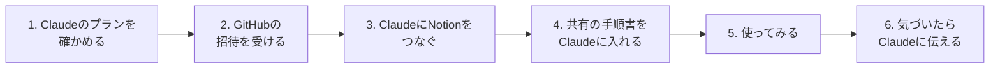

# はじめかた（導入マニュアル）

ClaudeとNotionのアカウントを持っていれば、30分ほどで始められます。GitHubは使ったことがなくて大丈夫です。

この仕組みが何なのかは [全体設計](design.md) にあります。ひとことで言うと、**Claudeへの作業の手順書（スキル）をみんなで共有して、使いながら一緒に良くしていく仕組み**です。会社のデータは共有しません。

## 全体の流れ

## 1. Claudeのプランを確かめる（1分）

共有の手順書（プラグイン）は、Claudeの**Pro以上**のプランで使えます。無料プランなら、Claudeの設定画面からProに切り替えてください（月$20、年払いなら月$17相当）。

## 2. GitHubの招待を受ける（10分）

共有の手順書は、GitHubというサービスの `winegrowers-commons` という場所に置いてあります。参加者には、この場所への招待メールが届いています。

1. 招待メール（件名に `winegrowers-commons` が入っている、GitHubからのメール）を開く
2. GitHubのアカウントが無ければ、メールのボタンから作る。メールアドレスは招待が届いたものにする
3. 「Join winegrowers-commons」（参加する）を押す

招待メールが見つからないときは、迷惑メールのフォルダも見てください。それでも無ければ、参加者の誰かに招待を送り直してもらってください。

## 3. ClaudeにNotionをつなぐ（3分）

Claudeが自分のNotionを読み書きできるようにします。

1. Claude（claude.ai かアプリ）の設定で「コネクタ」を開く
2. Notionを選んで「接続」を押し、Notionの画面で許可する

## 4. 共有の手順書をClaudeに入れる（5分）

1. Claudeで「カスタマイズ」→「プラグイン」を開く
2. 「追加」→「マーケットプレイスを追加」を選ぶ
3. `winegrowers-commons/wine-ai-commons` と入れて追加する
4. 一覧に出てくる「基盤（core）」を入れる
5. このマーケットプレイスの「自動で同期」をオンにする。これで、誰かが手順書を直すと、自分のClaudeにも自動で届きます

入れたプラグインはアカウント全体に効くので、どのチャット・どのプロジェクトでも使えます。

## 5. 使ってみる（10分）

新しいチャットで、たとえば次のように頼んでみてください。

- 「基盤の基本ルールを読んで、この仕組みで何ができるか教えて」
- 「来週の打ち合わせのメモを、人間向けの資料づくりのスキルで、分かりやすいNotionページにして」
- 「このページの全体像を、図解のスキルで図にして」

いま入っている基盤（core）には、次のスキルがあります。

| スキル | 何をするか |
| --- | --- |
| 基本ルール（basic-rules） | この仕組みで守る約束。会社のデータを共有側に出さない、など |
| 人に確認する線引き（when-to-ask） | Claudeが自分で進めるか、人に確認するかの決め方。確認するときは要点だけを分かりやすく聞く |
| 人間向けの資料づくり（writing-for-humans） | 要点が先に分かり、詳しく知りたければ追える資料の書き方 |
| 情報の構造の読み取り（structure-reading） | 長いページやメモを読んで、何が何を含み、どうつながるかを整理する |
| 図解（diagram） | 整理した構造から、分かりやすい図を作る |

畑・醸造・経理・補助金などの分野の手順書は、これから順に足していきます。

## 6. 気づいたらClaudeに伝える

使っていて「ここが違う」「こうしてほしい」と思ったら、そのままClaudeに言ってください。全員に役立つ気づきは、Claudeが名前や金額などを抜いたうえで改善の提案にまとめ、共有の手順書に反映されていきます。

自分で直接提案したいときは、GitHubの [Issues](https://github.com/winegrowers-commons/wine-ai-commons/issues) に書き込んでもかまいません。

## これから足すもの

- **🧭 AI設定ページ**：各自のNotionに置く、自分用の設定ページ。どのDBを使うか、自分だけのルールなどを書きます。作り方は、初期設定のスキルができたらここに足します
- **分野ごとのプラグイン**：補助金・調べもの・経理などから順に
