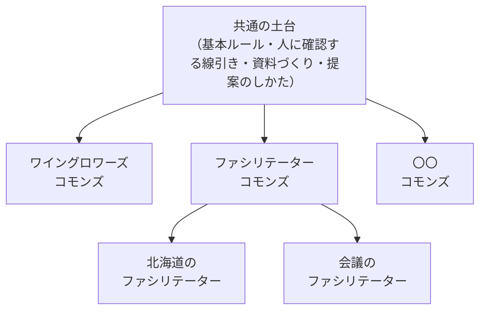

# 北極星のアイデア：仕事の進め方を、みんなで決めて育てるコモンズ

> これは決定版ではなく、向かう方角のメモ。設計を決めるときに「この方角に近づくか」を見る物差しに使う。2026年11月に参加者の会話から生まれた。

**一言でいうと**：データではなく**仕事の進め方（スキル）**を共有して育てる仕組みは、ワインに限らずどの業界にも作れる。参加者が増えたときにいちばん難しくなる「共有のルールをどう決めるか」は、**AI が実際に仕事をした記録と、各自の設定で試した影響**を材料にして、人が決める形で解ける。

## 1. なぜこれが新しいか

これまでの情報共有は、データ（記録・表・ファイル）を共有するものだった。このコモンズが共有するのは、データの作り方・使い方・仕事の進め方そのもの。各事業者の個性（自分の設定・自分のルール）は手元に残したまま、共有して育てられる部分だけを一緒に育てる。

大手が作った AI エージェントに仕事を任せる形とも違う。進め方を決めるのは、使っている人たち自身。

## 2. 業界ごとに作れる：「〇〇コモンズ」

仕組みの側（土台のスキル、つなぎ方、改善の回し方、決め方）は業界を知らなくていい。業界ごとに違うのは、上に乗る分野のスキルと知識だけ。

コモンズは入れ子になる。全国の下に地域、分野の下に専門。長く続く共有資源の自治を調べたエリノア・オストロムは、その条件の8つ目に「入れ子になった組織（nested enterprises）」を挙げている。大きな共有資源は、小さな地域のまとまりを土台に、何層にも重なって運営される。プラグインを重ねる今の作りは、この形にそのまま合う。

## 3. 共有のルールの決め方：3段

参加者が増えると、相反する提案や「変えたくない」という声が必ず出る。それを次の3段で扱う。

| 段 | やること | 誰が |
| --- | --- | --- |
| **① 重ねて解く** | 対立の多くは、土台を変えずに「困る人だけ自分の設定で上書き」で片づく。投票しない | 提案した人の AI |
| **② 影響を試す** | 決める前に、AI が各参加者の設定でその変更を試し、「誰が楽になり、誰が困るか」を報告する | 各自の AI（結果だけを出す） |
| **③ 人が決める** | ①で片づかないものだけ。どれを初期値にするか、全員に効く約束をどう変えるか。論点の地図を AI が作り、人が決める | 参加者 |

②が、このコモンズならではのところ。政治の場では、政策を決める前に全員の暮らしで試すことはできない。コモンズでは、スキルを各自の設定に当てて試せる。意見を聞く前に、影響が見える。

③で使えそうな先例

- **vTaiwan と Pol.is**：台湾の市民参加の仕組み。参加者が短い意見を書き、互いの意見に賛否だけを付ける。Pol.is は参加者を似た考えのまとまりに分け、複数のまとまりをまたいで支持される「合意できる意見」を見つけ出す。対立の大きさではなく、共通点が見える
- **Collective Constitutional AI**：Anthropic が約1,000人の米国の人々と、AI の行動原則（憲法）を Pol.is で作った実験。人々の合意を AI のふるまいのルールに落とした先例。このコモンズの「みんなの意見から共有スキルを作る」に近い
- **二次投票（Quadratic Voting）**：持ち票を、強く望む案に重ねて使える投票。重ねるほど1票の値段が上がるので、少数でも強く困る人の声が届く。1人1つの本人確認が前提
- **無意識データ民主主義**：成田悠輔さんが『22世紀の民主主義』で名付けた考え方。選挙ではなく、人々の行動や反応のデータから決める。コモンズでは「AI が実際に仕事をした記録」がこのデータに当たる。ただし、データだけで決めることへの批判もあるので、このコモンズでは③で人が決める形を残す

## 4. 守ること

- **事業データは出さない**：影響の報告で共有側に出すのは「困る／困らない」「どの手順か」まで。中身の値・名前・金額は出さない（基本ルールの延長）
- **最後は人が決める**：AI がするのは、論点の地図づくりと影響の見積もり。全員に効く約束は、人の合意で変える
- **上書きできる余地を残す**：共有スキルは、全員の約束を除いて、各自の設定で上書きできるように書く。上書きできないスキルは、対立を投票に持ち込んでしまう
- **誰が書いたかが分かる**：提案にも、共有の Notion への書き込みにも、書いた人の名前が付く

## 5. いまの設計への反映

| 北極星に近づく変更 | いま |
| --- | --- |
| 基本ルールに「どれが優先か」を書き、全員の約束と既定値を分ける（①の前提） | 済み |
| 提案のしかたをスキルにし、提案に「効く層」と「各自の設定で試した影響」を付ける（②の入り口） | 済み |
| 共有の Notion への書き込みに、書いた人の名前を自動で付ける | 済み（コモンズの MCP サーバー） |
| 土台（core）に特定の業界の決めごとを入れない。業界のことは分野のプラグインに置く | 済み（例としてワインが出るだけ） |
| 提案を集めて論点の地図を作る（Pol.is 型） | 参加者が増えてから |
| 参加者ごとの影響テストを自動で回す | 提案が月に数件を超えてから |
| 別の業界のコモンズを立てるための手順（〇〇コモンズの作り方） | 2つ目のコモンズの話が出てから |

## 参考

- [MIT Technology Review：台湾が法律づくりに使う仕組み（vTaiwan・Pol.is）](https://www.technologyreview.com/2018/08/21/240284/the-simple-but-ingenious-system-taiwan-uses-to-crowdsource-its-laws/)
- [Anthropic：Collective Constitutional AI](https://www.anthropic.com/research/collective-constitutional-ai-aligning-a-language-model-with-public-input)
- [P2P Foundation：オストロムの8つの設計原則](https://blog.p2pfoundation.net/eight-design-principles-for-successful-commons/)
- [文藝春秋：成田悠輔『22世紀の民主主義』と無意識データ民主主義](https://bunshun.jp/bungeishunju/articles/h4581)
