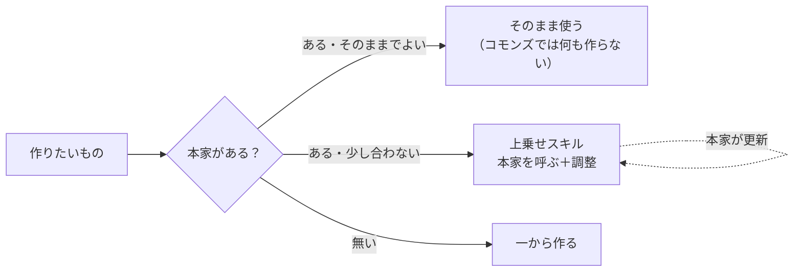

# スキルの作り方

要点は3つ。

1. **車輪を作り直さない。** 公式（Anthropic）や世の中にすでにあるスキルは、まずそのまま使う
2. **足りない分だけを上乗せする。** 本家の中身は写さず、「本家を呼ぶ ＋ 日本・ワイン生産者向けの調整」だけを書く
3. **本家が更新されたら、そのまま新しい版を使う。** 調整は別のファイルにあるので消えない



## 1. まず本家を探す

作る前に、次の順で探す。見つけたものはプルリクエストの本文に書く（無かったことも書く）。

1. Anthropic の公式：`anthropics/skills`、`anthropics/knowledge-work-plugins`（中小企業向けの `small-business`、`finance` など）、Claude の設定画面のディレクトリ
2. 分野の公開スキル集：農業なら `human-avatar/skills-for-agriculture`。ほかは ComposioHQ や travisvn の awesome-claude-skills の一覧
3. このリポジトリの中（同じものを2つ作らない）

使ってよい本家は、ライセンスが利用を認めているもの（MIT、Apache-2.0 など）だけ。ライセンスが無いものは呼ばない。

## 2. 3つの形から選ぶ

| 形 | いつ | コモンズに置くもの |
| --- | --- | --- |
| そのまま使う | 本家のままで日本の生産者にも使える | 何も置かない。`docs/` のおすすめ一覧に名前を書くだけ |
| 上乗せ | 本家は使えるが、日本の制度・ツール・ワインの事情が合わない | 上乗せスキル（下の3） |
| 一から作る | 本家が無い（酒税、農薬の使用基準、日本の補助金など） | ふつうのスキル |

## 3. 上乗せスキルの書き方

本家の手順を書き写さない。書くのは次の4つだけ。

```markdown
---
name: （コモンズでの名前）
description: （いつ使うか。「〇〇（本家）の代わりにこちらを使う」と書く）
---

# 〇〇

## 本家
- 名前：small-business の cash-flow-snapshot（Anthropic 公式、Apache-2.0）
- 原文：https://github.com/anthropics/knowledge-work-plugins/blob/main/small-business/skills/cash-flow-snapshot/SKILL.md

## 本家の読み方
## 調整（本家と違うところだけ）
## 本家とぶつかったとき
```

- **本家の読み方**：本家が入っていれば、そのスキルを呼んで手順に従う。入っていなければ、原文のURLを開いて読み、その手順に従う。原文が開けないときは、その旨を伝えて調整だけで進めず止まる
- **調整**：「何を・なぜ変えるか」を目的で書く。本家の何行目を書き換える、のような書き方はしない（本家の文面が変わると壊れるため）
- **ぶつかったとき**：本家の新しい版と調整が食い違ったら、調整の目的を優先して進め、propose-change で「調整の見直し」を提案する。どちらに従ったかを結果に一言書く

### なぜ「入っていれば呼ぶ、無ければ原文を読む」か

- プラグインの依存（`dependencies`）で本家を必ず入れる方法もあるが、claude.ai のアプリでは入れられないプラグイン（`bin/` を持つものなど）があり、そのとき上乗せ側まで動かなくなる
- 本家が大きなプラグインだと、使わないスキルまで全員に入る
- 原文を毎回読めば、本家が更新されたその日から新しい版が使われる。調整はこちらのファイルにあるので残る

`dependencies` を使ってよいのは、本家が小さく、claude.ai のアプリでも入れられると確かめたときだけ。

## 4. 一から作るとき・移すとき

- 書き方は writing-for-humans、図は diagram に従う
- DBは論理名で呼ぶ。URL・ID・人名・金額・取引先名は書かない（CLAUDE.md の「入れてはいけないもの」）
- その事業者だけの事情（会社名、定款の条文、トンマナ、圃場名）は書かず、「🧭 AI設定ページの自分ルールから読む」と書く
- 別の場所から移すときは、5の「置き場を移すとき」に従う

## 5. 正本は1か所。置き場は2つだけ

同じスキルが2か所にあると、どちらが新しいか分からなくなる。だから、スキルの**正本（直す場所）**は次の2つだけにし、それ以外にあるものはすべて写しとして扱う。

| 置き場 | 置くもの | 直す場所 |
| --- | --- | --- |
| **コモンズ**（このリポジトリ） | みんなで使うスキル | ここだけ（プルリクエスト） |
| **自分だけのスキル**（各自のNotionのスキルDB） | 1つの事業者だけの事情に寄ったスキル（自社のトンマナ、自社だけの業務） | そのページ |

写し（直さない。直しても次の同期で消える）：

- Claude のプラグイン：コモンズからマーケットプレイスの「自動で同期」で届く
- 各自のNotionのスキルDBにある、コモンズのスキルと同じ名前のページ：`tools/notion-skill-sync/` が入れ直す

### しないこと

- **Claude のアカウントに「個人のスキル」として同じものを置かない。** Claudeの設定画面のスキルは、どこにも元が無いので迷子になる。自分だけのスキルはNotionのスキルDBに置き、ClaudeからはNotionのコネクタで読む。試しに作ったときも、使うと決めたらすぐNotionかコモンズへ移し、Claude側からは消す
- 同じ役目のスキルを、名前を変えて別の場所に作らない

### 作る前に探す

新しく作る前に、**コモンズと自分のNotionのスキルDBの両方**を、名前と説明文で探す。同じ役目のものがあれば、作らずにそれを直す（コモンズなら提案、自分のものならそのページ）。

### 置き場を移すとき

自分だけのスキルをみんなに広げるときや、ほかの場所から移すとき：

1. 新しい正本を作る
2. 元のページの名前の頭に「（移行済み→新しい正本の名前）」を付ける
3. 写しが届いて動くのを確かめたら、元を消す（消すのは本人。Claudeのアカウントのスキルは設定画面から）

### 迷子を見つける

スキルのことで迷ったら、Claudeに「このスキルの正本はどこ？」と聞く。Claudeは上の2か所を探し、写しや迷子（Claudeのアカウントにだけあるもの、移行済みのまま残っている元のページ）があれば一覧にして、移すか消すかを提案する。

## 6. 出す前の確認

- [ ] 本家を探した結果をプルリクエストの本文に書いた
- [ ] 上乗せなら、本家の手順を書き写していない
- [ ] 本家の原文URLとライセンスを書いた
- [ ] 事業データ・1社だけの事情が入っていない
- [ ] 同じ役目のスキルが、コモンズにも自分のNotionのスキルDBにも無いことを確かめた
- [ ] プラグインの `version` を上げた
