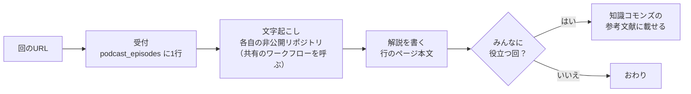

# ポッドキャスト解説

回のURLから、音声の文字起こし → 日本語の解説 → 各自のNotionの `podcast_episodes` へ、までを一続きでやる。栽培・醸造・経営など生産者みんなに役立つ回は、自分の言葉でまとめた解説を知識コモンズの参考文献に載せる。



## 0. 設定を読む

🧭 AI設定ページから、次の2つを読む。どちらかが無ければ、`references/setup.md` の準備をしてから進む。

| 名前 | 中身 |
| --- | --- |
| `podcast_episodes` | 回を貯めるDB（接続表） |
| `podcast_repo` | 文字起こしの場所。各自の非公開リポジトリ（設定値） |

## 1. 受け付ける

- チャットでURLを渡されたら、`podcast_episodes` にそのURLの行が無いか確かめ、無ければ「タイトル＝URL、URL＝URL、状態＝受付」で1行足す
- 「受付をまとめて処理して」なら、状態が受付の行を全部拾う
- Spotify のURLは音声が取れない。同じ回の Apple Podcasts（URLに `?i=` が付いたもの）か Pocket Casts のURLを探して差し替える。見つからなければ状態をエラーにし、メモに理由を書く

## 2. 文字起こしを起動する

`podcast_repo` のワークフロー `transcribe.yml` を、行ごとに起動する。中身の処理は共有リポジトリの `podcast-transcribe.yml` にある。

```
gh api -X POST repos/<podcast_repo>/actions/workflows/transcribe.yml/dispatches \
  -f ref=main -f 'inputs[url]=<行のURL>' -f 'inputs[request_id]=<NotionページID>'
```

- 外国語の回は `-f 'inputs[language]=en'` のように言語を付ける。付けないと auto（タイトルが日本語なら ja に固定、それ以外は区間ごとに判定）
- 起動したら状態を「文字起こし中」にする
- `actions/runs` で表示名が `transcribe <NotionページID>` の実行を見つけ、30秒おきに終わるのを待つ（50分の回で7分ほど）
- 失敗したら、ジョブのログの末尾を読む。入力の誤りなら直して起動し直す。仕組みの誤りなら、状態をエラーにしてメモに理由を書き、propose-change で共有に提案する
- 音声のファイルは、Claude の作業環境から直接は取れないことが多い（通信の制限）。必ず Actions で取る

## 3. 取り込む

`podcast_repo` の `episodes/<配信日>_<ID>/` から `meta.json` と `transcript.md` を読み、行にタイトル・番組・配信日・長さ（分）・ゲスト・文字起こし（transcript.md のURL）を入れ、状態を「文字起こし済」にする。番組やテーマの選択肢が無ければ、DBに選択肢を足してから入れる。

`transcript.md` は自動の文字起こしなので、固有名詞を誤ることが多い。概要欄・番組のページ・検索で正しい名前を確かめてから使う。

## 4. 解説を書く

行のページ本文に、`references/page-template.md` の型で書く。終わったら一言まとめ・テーマを入れ、状態を「解説済」にする。

## 5. 知識コモンズに載せる（みんなに役立つ回だけ）

栽培・醸造・病害虫・土壌・販売・経営・制度など、ワイン生産者に役立つ知識を含む回だけが対象。雑談や、分野の外の回は載せない。

1. 載せる前に本人に確かめる（共有の場への書き込みなので）。本人が🧭 AI設定ページの自分ルールで「確認なしでよい」としていれば、確かめずに載せる。人が見ていない実行では載せず、メモに「知識コモンズ候補」と書いて残す
2. 知識コモンズの入口（コネクタ Winegrowers Commons）で、参考文献のDBを探し、列の定義を読んでから1行作る
   - 種類はポッドキャスト、タイトル・番組・配信日・出演者・元URLを入れる
   - 本文には、解説のうち「この回の核心」と、生産者に役立つ論点の要約だけを自分の言葉で書く。書き起こし・長い引用・本人の感想や自社の事情は載せない（🔒 基本ルール4）
   - 同じ回がすでにあれば、作らずにそれを使う
3. 載せたページのURLを、行の「知識コモンズ」に入れる

## 伝え方

チャットでは、ページへのリンクと一言だけ返す。長い要約はページに書いてあるので繰り返さない。
