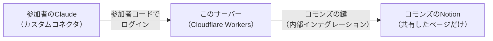

# コモンズの Notion につなぐ MCP サーバー

参加者の Claude から、コモンズの共有 Notion（知識コモンズ）を読み書きするための中継です。Cloudflare Workers の無料枠で動かします。

## なぜこの形か

- Notion の公式コネクタは、ワークスペースの**メンバー**しかつなげない。コモンズでは世話役1人だけがメンバーで、ほかの人はゲスト（無料で入れる）なので、公式コネクタでは読み書きできない
- そこで、コモンズに鍵（内部インテグレーション）を1つ作り、このサーバーがその鍵で読み書きする。参加者は自分の Claude にこのサーバーを足すだけ
- 鍵が届くのは、その鍵に共有したページ（と子ページ）だけ

## 参加者がつなぐ手順

1. Claude で「カスタマイズ（Customize）」→「コネクタ（Connectors）」→「＋」→「カスタムコネクタを追加（Add custom connector）」
2. 名前は `Winegrowers Commons`、URL は世話役から届いた `https://…workers.dev/mcp`
3. 「接続（Connect）」を押すと、参加者コードを入れる画面が出る。世話役から受け取ったコードを入れて「つなぐ」

## できること

| ツール | すること |
| --- | --- |
| commons_search | ページとデータベースをタイトルで探す |
| commons_read | ページのプロパティと本文を読む。DBのIDなら列の定義を返す |
| commons_query_database | DBの行を条件で引く |
| commons_create_page | 子ページかDBの行を作る |
| commons_append | ページの末尾に書き足す |
| commons_update_properties | DBの行のプロパティを変える |
| commons_comment | ページにコメントする |

消す・アーカイブする道具は入れていない（戻せない操作は人が Notion の画面でする）。書き込みの末尾には、書いた人の名前が自動で付く（Notion 上の記録はすべて鍵の名前になるため）。

## 世話役が動かすとき（初回のみ）

手順

1. Cloudflare にログインし、`npx wrangler login`
2. `npx wrangler kv namespace create OAUTH_KV` で出た id を `wrangler.jsonc` の `REPLACE_AFTER_KV_CREATE` に入れる
3. `PUBLIC_URL` を、デプロイ先の `https://winegrowers-commons-mcp.<サブドメイン>.workers.dev` にする
4. 鍵を Worker の secret に入れる（リポジトリには入れない）
   - `npx wrangler secret put NOTION_TOKEN`：Notion の「開発者ツール」→ コネクト「Commons MCP」の API トークン
   - `npx wrangler secret put MEMBER_CODES`：`{"参加者コード":"表示名", …}` の JSON。参加者を足すときはこれを入れ直す
5. `npm install && npx wrangler deploy`

## 無料枠の目安

Workers の無料プランは1日10万リクエスト、KV は1日10万回の読み取りと1,000回の書き込み（2026年11月時点、Cloudflare の公式の制限表による）。数人で使う分には十分。
