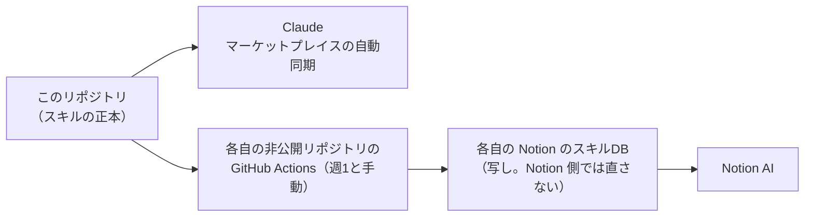

# Notion のスキルDBへ写す

コモンズのスキルの正本はこのリポジトリにある。Notion AI からも同じスキルを使えるように、各自の Notion のスキルDBへ写しを入れ直す。



- 写しはスキルの `name` と同じタイトルのページ。中身が変わったものだけ入れ直す
- 写しを Notion 側で直しても、次の同期で上書きされる。直したいときはコモンズに提案する（core の propose-change）
- Notion の鍵は各自の非公開リポジトリの secrets にだけ置く。ここには置かない

## 準備（1人1回）

1. Notion で接続（内部インテグレーション）を作り、権限を「コンテンツを読む・挿入する・更新する」にする。スキルDBをその接続に共有する
2. スキルDBのデータソースIDを控える（スキルDBを開き、「…」→「データソースを管理」などから。Claude に「スキルDBのデータソースIDを調べて」と頼んでもよい）
3. 自分の非公開リポジトリ（ポッドキャストの文字起こしと同じものでよい）の Settings で、
   - Secrets に `NOTION_TOKEN`（1の鍵）
   - Variables に `SKILLS_DATA_SOURCE_ID`（2のID）
4. `caller.yml` を、そのリポジトリの `.github/workflows/notion-skill-sync.yml` に置く
5. Actions の画面から一度手で動かし、スキルDBに写しができたことを確かめる

## 手元で何が写るか見る

```
DRY_RUN=1 python tools/notion-skill-sync/sync.py
```
